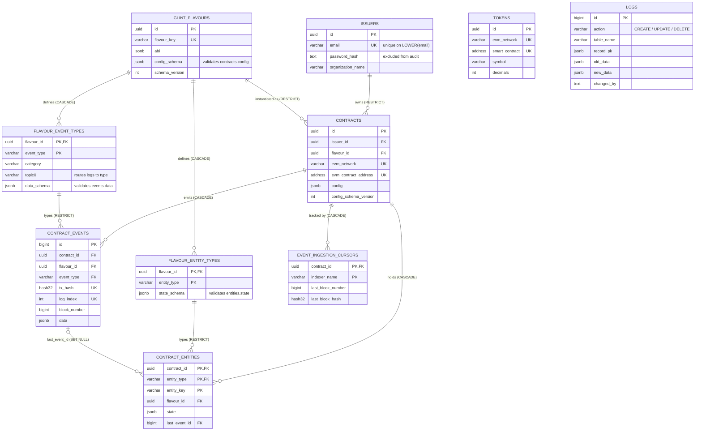

# Glint Ecosystem: Database Schema Technical Note (v4)

## 1. Overview

The Glint schema is a PostgreSQL 13+ database that stores, decodes and derives state from EVM smart-contract activity. It is **flavour-agnostic**: no table is specific to one contract type. Instead, the kinds of contracts the platform supports ("flavours"), the events they emit and the state objects derived from those events are all described as **data** in a registry. The application reads that registry to decide how to decode, validate and store everything else.

The schema is organised in three Postgres schemas:

| Schema | Purpose |
|---|---|
| `blockchain` | Registry, contracts, raw events, derived entities, indexer cursors, tokens |
| `schema_logs` | The audit trail (`logs`) |
| `public` | Platform users (`issuers`) |

Conventions used throughout:

- Addresses and hashes are stored **lowercase** and enforced by domains.
- There are **no `created_at` / `updated_at` columns** (v4 decision). Row history lives in `schema_logs.logs`.
- The script is **idempotent** (`IF NOT EXISTS`, `DROP TRIGGER IF EXISTS`, guarded domain creation).
- Postgres does not validate JSON Schema natively, so the **application validates JSONB writes** against the schemas stored in the registry.

---

## 2. Entity relationship summary

The diagram shows every table, its key columns and the relationships between them. Tables are grouped by role below the diagram.



**Reading the diagram**

| Group | Tables | Role |
|---|---|---|
| Registry (defines what is allowed) | `glint_flavours`, `flavour_event_types`, `flavour_entity_types` | Flavours, their events and their derived-state types, each with a JSON Schema |
| Platform | `issuers`, `contracts`, `tokens` | Who deploys what, and where |
| Chain data (produced by the indexer) | `contract_events`, `contract_entities`, `event_ingestion_cursors` | Decoded logs, derived state and indexer progress |
| Audit | `schema_logs.logs` | Written by triggers; no foreign keys by design |

Notes:

- `contract_events` and `contract_entities` also reference `contracts (id, flavour_id)` as a composite key, which guarantees a row's flavour always matches its contract's flavour. The diagram shows the simple `contract_id` link for readability.
- `tokens` is a standalone reference table with no foreign keys.
- `logs` has no relationships: it records `table_name` and `record_pk` as data, so it can audit any table.
- The labels in brackets show the `ON DELETE` behaviour of each relationship.

---

## 3. Shared infrastructure

### 3.1 Domains

| Domain | Definition | Purpose |
|---|---|---|
| `blockchain.evm_address` | `VARCHAR(42)`, must match `^0x[0-9a-f]{40}$` | Guarantees every address is a well-formed, lowercase 20-byte hex value. Prevents duplicates caused by checksum-case differences. |
| `blockchain.evm_hash32` | `VARCHAR(66)`, must match `^0x[0-9a-f]{64}$` | Same guarantee for 32-byte hashes (tx hashes, block hashes, topic0). |

### 3.2 `schema_logs.logs` (audit trail)

One row per `INSERT`, `UPDATE` or `DELETE` on an audited table.

| Column | Role |
|---|---|
| `id` | Surrogate key (`BIGSERIAL`) |
| `action` | `CREATE`, `UPDATE` or `DELETE` |
| `table_name` | Name of the affected table |
| `record_pk` | JSONB of the affected row's primary-key columns (supports composite keys) |
| `old_data` / `new_data` | Row snapshots before and after the change |
| `changed_by` | Actor. Defaults to the session setting `app.current_user` |
| `logged_at` | Timestamp of the log entry |

A `CHECK` constraint (`logs_payload_matches_action`) enforces the payload shape: `CREATE` has only `new_data`, `DELETE` has only `old_data`, `UPDATE` has both. Indexes cover lookups by table and time, by action, and by primary key (GIN on `record_pk`).

The application should set the actor per transaction:

```sql
SET LOCAL app.current_user = '<issuer id or service name>';
```

### 3.3 `blockchain.log_row_change()` (audit trigger function)

A generic `AFTER ROW` trigger function that writes to `schema_logs.logs`.

- **Arguments:** the first is a comma-separated list of primary-key columns (default `id`); the optional second is a comma-separated list of columns to exclude from the logged snapshots.
- **No-op suppression:** an `UPDATE` that changes nothing (after exclusions) is skipped.
- **Sensitive columns:** exclusions keep secrets out of the log (for example `issuers.password_hash`).

Because v4 has no timestamp columns, this trigger is the single source of truth for "when and by whom was this row changed".

---

## 4. Tables

### 4.1 Registry tables (the dynamic core)

#### `blockchain.glint_flavours`
The root of the registry. One row per supported contract type.

| Column | Purpose |
|---|---|
| `id` | UUID primary key |
| `flavour_key` | Unique machine key |
| `display_name` | Unique human-readable name |
| `description` | Free text |
| `abi` | Full contract ABI (JSONB), used by the indexer to decode logs |
| `config_schema` | JSON Schema describing the shape of `contracts.config` for this flavour |
| `schema_version` | Version counter for the flavour's definition (> 0) |
| `is_active` | Soft switch to disable a flavour without deleting it |

`config_schema` must be a JSON object. Audited.

#### `blockchain.flavour_event_types`
Every event a flavour can emit. Composite PK `(flavour_id, event_type)`.

| Column | Purpose |
|---|---|
| `event_type` | Flavour-defined name of the event |
| `category` | Free-form, flavour-defined grouping |
| `topic0` | `keccak256` of the event signature, used to **route a raw log to its event type** |
| `abi_fragment` | ABI entry for this single event |
| `data_schema` | JSON Schema that validates `contract_events.data` |
| `schema_version`, `is_active` | Versioning and soft-disable |

A **partial unique index** on `(flavour_id, topic0)` (where `topic0 IS NOT NULL`) allows one event type per signature within a flavour, and an index on `(flavour_id, category)` supports category lookups. Cascades on flavour deletion. Audited.

#### `blockchain.flavour_entity_types`
Derived state objects the program maintains from events. Composite PK `(flavour_id, entity_type)`.

| Column | Purpose |
|---|---|
| `entity_type` | Flavour-defined name of the object type |
| `description` | What the object represents |
| `state_schema` | JSON Schema that validates `contract_entities.state` |
| `schema_version`, `is_active` | Versioning and soft-disable |

Audited.

### 4.2 Platform tables

#### `issuers` (schema `public`)
Accounts that deploy and own contracts.

| Column | Purpose |
|---|---|
| `id` | UUID primary key |
| `display_name` | Optional unique public name |
| `email` | Login identifier. Unique **case-insensitively** via `uq_issuers_email_lower` on `LOWER(email)` |
| `password_hash` | Credential hash. **Excluded from the audit log** |
| `organization_name`, `description`, `website` | Profile information |

Audited, with `password_hash` excluded.

#### `blockchain.tokens`
Optional generic ERC-20 reference data, scoped per network.

| Column | Purpose |
|---|---|
| `evm_network` | Network identifier |
| `smart_contract` | Token address (`evm_address`) |
| `symbol`, `decimals` | Display metadata. `decimals` is checked to be between 0 and 77 |
| `is_active` | Soft switch (with a partial index for active rows) |

Unique on `(evm_network, smart_contract)`. Audited.

### 4.3 Deployment table

#### `blockchain.contracts`
One row per deployed contract instance: deployment metadata in typed columns, flavour-specific parameters in JSONB.

| Column | Purpose |
|---|---|
| `issuer_id` | Owner (`ON DELETE RESTRICT`: an issuer with contracts cannot be deleted) |
| `flavour_id` | The flavour this contract is an instance of (`ON DELETE RESTRICT`) |
| `name` | Display name |
| `evm_network`, `evm_contract_address` | Where it lives. Unique together |
| `deployment_tx_hash`, `deployed_block` | Provenance, also a useful indexer start point |
| `config` | Flavour-specific configuration, validated against `glint_flavours.config_schema` |
| `config_schema_version` | The flavour `schema_version` used to validate `config` |

`unique_contract_id_flavour (id, flavour_id)` exists so child tables can reference both columns and **guarantee a child row's flavour matches its contract's flavour**. `contracts_config_is_object` ensures `config` is a JSON object. Audited.

### 4.4 Chain data tables

#### `blockchain.contract_events`
One row per on-chain log, raw and decoded together. This is the **append-only record of what happened on chain**.

| Column | Purpose |
|---|---|
| `id` | `BIGSERIAL` primary key |
| `contract_id`, `flavour_id` | Owning contract (composite FK to `contracts (id, flavour_id)`, cascades on delete) |
| `event_type` | Must exist in `flavour_event_types` for this flavour (composite FK, `RESTRICT`) |
| `schema_version` | Version of the event's `data_schema` used for this row |
| `tx_hash`, `log_index` | Log identity. Unique with `contract_id` (`unique_event_log`), making ingestion **idempotent** |
| `block_number`, `block_hash`, `block_timestamp` | Chain position and chain time |
| `emitter` | Address that emitted the log |
| `topics` | Raw topics (JSON array) |
| `data` | Decoded payload (JSON object), validated by the event type's `data_schema` |

Indexes cover access by contract and block order, by contract plus type (newest first), by flavour and type, by tx hash and by timestamp, plus a GIN index on `data` for JSON containment queries. **Not audited**: it is append-only chain data with its own timestamps.

#### `blockchain.contract_entities`
Generic derived state: one row per object, keyed by `(contract_id, entity_type, entity_key)`.

| Column | Purpose |
|---|---|
| `entity_type` | Must exist in `flavour_entity_types` for this flavour (composite FK, `RESTRICT`) |
| `entity_key` | Flavour-defined identifier of the object |
| `state` | Current state (JSON object), validated by `state_schema` |
| `schema_version` | Version of `state_schema` used |
| `last_event_id` | The event that last changed this entity (`ON DELETE SET NULL`) |
| `last_block` | Block of the last change |

Indexed by `(flavour_id, entity_type)` and by GIN on `state`. **Not audited**: it is high-churn and can be **rebuilt by replaying `contract_events`**. An optional audit trigger is provided in the script comments.

#### `blockchain.event_ingestion_cursors`
Indexer progress, one row per `(contract_id, indexer_name)`.

| Column | Purpose |
|---|---|
| `indexer_name` | Allows several independent indexers (for example live and backfill) per contract |
| `last_block_number` | Last block processed (>= 0) |
| `last_block_hash` | Hash of that block, useful for **reorg detection** |

**Not audited**, because it is written constantly.

### 4.5 `contract_events` vs `contract_entities`

The two tables hold related data but answer different questions. **Events record what happened. Entities record what is true now.**

#### Differences

| Aspect | `contract_events` | `contract_entities` |
|---|---|---|
| Question answered | "What happened, and when?" | "What is the current state of object X?" |
| Nature | Immutable history, one row per on-chain log | Mutable current state, one row per object |
| Source | Decoded directly from chain logs | Computed by the program from events |
| Write pattern | Append-only, never updated | Updated in place whenever a related event arrives |
| Row identity | `(contract_id, tx_hash, log_index)` | `(contract_id, entity_type, entity_key)` |
| Typing | `event_type` from `flavour_event_types`, payload in `data` | `entity_type` from `flavour_entity_types`, payload in `state` |
| Validated by | `data_schema` | `state_schema` |
| Volume | Grows with every log, indefinitely | Grows with the number of distinct objects |
| Source of truth? | **Yes** | **No**, it is derived |
| Rebuildable? | Only by re-reading the chain | Yes, by replaying `contract_events` |
| Audited in `logs`? | No (chain data has its own timestamps) | No (high churn, rebuildable) |
| Traceability | `block_number`, `block_hash`, `block_timestamp` | `last_event_id` and `last_block` point back to the event that last changed it |

#### How they work together

```
chain log ──► contract_events (append) ──► program applies event ──► contract_entities (upsert)
                    ▲                                                        │
                    └────────────── last_event_id ◄──────────────────────────┘
```

Each event is stored once. If it affects an object, the program updates that object's entity row and records which event did so. If entities are ever wrong or the entity schema changes, the table can be truncated and rebuilt by replaying events in `(block_number, log_index)` order.

#### Example

For a hypothetical vault flavour, three events occur for user `0xabc...`:

| Event (`contract_events`) | `data` |
|---|---|
| `Deposited` | `{"user":"0xabc...","amount":"100"}` |
| `Deposited` | `{"user":"0xabc...","amount":"50"}` |
| `Withdrawn` | `{"user":"0xabc...","amount":"30"}` |

`contract_events` keeps all three rows. `contract_entities` keeps one row for entity type `position`, key `0xabc...`, with `state = {"balance":"120"}`, and `last_event_id` pointing at the `Withdrawn` row.

#### When `contract_entities` is actually needed

It earns its place when you need the **current state of an object**, particularly when that state is not a single event's payload:

1. **State depends on many events.** A balance, status or lifecycle stage (for example open, then partially filled, then closed) is the result of folding a sequence of events. Reading it from the event log means replaying that sequence on every query.
2. **Frequent "current value" reads.** APIs and UIs usually ask "what is X now?", not "list everything that ever happened to X". An entity gives a single-row lookup by primary key.
3. **Lookup or filtering by object.** Queries like "all positions with `state.status = 'active'`" are served by the GIN index on `state`. Doing this over events means finding the latest event per object first.
4. **Cross-event logic.** Rules such as "an object can only close if it is open" or "status is derived from the last three events" need a place to keep intermediate state while processing the stream.
5. **Event history is large.** Once a contract has millions of logs, recomputing state from events per request stops being practical.
6. **Several consumers share one interpretation.** Entities store the program's interpretation of the events once, so every reader sees the same state instead of re-implementing the folding logic.

#### When it is not needed

You can skip entities (leave a flavour with no rows in `flavour_entity_types`) when:

- The flavour only needs an **activity feed or history** (transfers, logs, audit-style listings), which `contract_events` already serves.
- Each event is **self-contained**: the answer is in one event's `data`, with no accumulation.
- Questions can be answered by a **simple SQL aggregate or view** over events (for example `COUNT`, `SUM` by type) at acceptable speed.
- Volume is small enough that a `DISTINCT ON` query for the latest event per key is fast.

A middle path is a **view or materialised view** over `contract_events`. It avoids a second write path, but it recomputes (or must be refreshed) rather than being updated incrementally, and it cannot easily hold state that is not directly expressible as a query over events.

#### Costs to weigh

| Cost | Detail |
|---|---|
| Extra write path | Every relevant event triggers an entity upsert, and the logic must be correct and idempotent |
| Consistency risk | Entities can drift from events if the apply logic has bugs, which is why replay must remain possible |
| Reorg handling | After a chain reorganisation, affected events are removed and entities must be rolled back or rebuilt (see `event_ingestion_cursors.last_block_hash`) |
| Schema evolution | A change to `state_schema` means bumping `schema_version` and rebuilding or migrating the affected rows |

**Rule of thumb:** if a consumer needs "the current X" and X is built from more than one event, add an entity type. If consumers only need "what happened", `contract_events` alone is enough.

---

## 5. A dynamic schema system

This schema is a **dynamic schema system**. It does not hard-code any particular contract type. Adding a new contract type, a new event or a new kind of derived state requires **no DDL**: no `CREATE TABLE`, no `ALTER TABLE`, no migration. It only requires inserting rows into the registry. Four mechanisms make this work.

### 5.1 A registry that describes the data

| Registry column | Describes | Validates |
|---|---|---|
| `glint_flavours.config_schema` | Shape of a contract's configuration | `contracts.config` |
| `flavour_event_types.data_schema` | Shape of each event's decoded payload | `contract_events.data` |
| `flavour_entity_types.state_schema` | Shape of each derived object's state | `contract_entities.state` |

Each holds a **JSON Schema** document, so the registry is a machine-readable data dictionary that lives inside the database.

### 5.2 Generic storage tables with JSONB payloads

`contracts`, `contract_events` and `contract_entities` have a **fixed set of typed columns** for what is universal (identity, chain position, ownership) and **one JSONB column** for what varies by flavour (`config`, `data`, `state`). New flavours reuse the same physical tables.

### 5.3 Referential integrity tied to the registry

Dynamic does not mean unconstrained. Composite foreign keys ensure data only references definitions that exist and belong to the right flavour:

- `contract_events (flavour_id, event_type)` must exist in `flavour_event_types`.
- `contract_entities (flavour_id, entity_type)` must exist in `flavour_entity_types`.
- `contract_events` and `contract_entities` reference `contracts (id, flavour_id)`, so a row's `flavour_id` must equal its contract's `flavour_id`. A contract of flavour A can never hold an event type from flavour B.
- Registry rows are protected with `ON DELETE RESTRICT` where instance data depends on them.

### 5.4 Versioning

Every registry row carries a `schema_version`, and instance rows record the version they were validated against (`contracts.config_schema_version`, `contract_events.schema_version`, `contract_entities.schema_version`). A flavour's definitions can evolve while older rows stay interpretable, and rows written under an outdated version can be found and migrated. `is_active` flags let you retire a flavour, event type or entity type without deleting history.

### 5.5 Runtime flow

1. **Register a flavour.** Insert into `glint_flavours` (ABI, `config_schema`), then into `flavour_event_types` (`topic0`, `abi_fragment`, `data_schema`) and `flavour_entity_types` (`state_schema`).
2. **Deploy a contract.** Insert into `contracts`. The application validates `config` against `config_schema` and records `config_schema_version`.
3. **Ingest logs.** The indexer matches each log's `topic0` to an `event_type`, decodes it with the ABI, validates it against `data_schema` and inserts into `contract_events`. The unique `(contract_id, tx_hash, log_index)` key makes re-ingestion safe, and `event_ingestion_cursors` records progress.
4. **Derive state.** The program applies events to create or update rows in `contract_entities`, validating `state` against `state_schema` and recording `last_event_id` and `last_block`.
5. **Audit.** Changes to registry, issuer, token and contract rows are recorded in `schema_logs.logs` by triggers.

### 5.6 Illustrative example

The values are hypothetical and only show that a new flavour is added with data alone:

```sql
INSERT INTO blockchain.glint_flavours (flavour_key, display_name, abi, config_schema)
VALUES ('example_vault', 'Example Vault', '[...]'::jsonb,
        '{"type":"object","required":["asset"],"properties":{"asset":{"type":"string"}}}');

INSERT INTO blockchain.flavour_event_types (flavour_id, event_type, category, topic0, data_schema)
SELECT id, 'Deposited', 'funds', '0x<keccak256 of the signature>',
       '{"type":"object","required":["user","amount"]}'
FROM blockchain.glint_flavours WHERE flavour_key = 'example_vault';

INSERT INTO blockchain.flavour_entity_types (flavour_id, entity_type, state_schema)
SELECT id, 'position', '{"type":"object","required":["balance"]}'
FROM blockchain.glint_flavours WHERE flavour_key = 'example_vault';
```

After this, the indexer can ingest `Deposited` events and maintain `position` entities for any contract of that flavour with no schema change.

---

## 6. Design decisions and trade-offs

| Decision | Rationale | Trade-off |
|---|---|---|
| JSON Schema validated in the application | Postgres has no native JSON Schema validation, and keeping schemas as data keeps the system dynamic | JSONB contents depend on the application. The database only enforces object/array shape (`jsonb_typeof` checks) |
| Audit via triggers instead of timestamp columns (v4) | One consistent history mechanism with before/after snapshots and the actor | No "last modified" column. Such questions require querying `logs` |
| `contract_events` and `contract_entities` not audited | Events are append-only with chain timestamps. Entities are high-churn and rebuildable | Manual edits to these tables are not tracked unless the optional trigger is added |
| Composite keys for flavour consistency | The database itself prevents cross-flavour data | Wider keys and foreign keys |
| GIN `jsonb_path_ops` indexes on payloads | Fast containment (`@>`) queries on `data`, `state` and audit `record_pk` | Larger indexes, extra write overhead, and not every JSONB operator is supported |
| Lowercase-only address/hash domains | Consistent matching, no case-related duplicates | Writers must normalise before insert or the domain check rejects the row |

## 7. Operational notes

- Set `app.current_user` with `SET LOCAL` in each transaction so audit rows carry the actor. Otherwise `changed_by` is `NULL`.
- Deleting a `contract` cascades to its events, entities and cursors.
- Event types and entity types cannot be deleted while events or entities use them (`RESTRICT`). Set `is_active = FALSE` to retire them instead.
- When a flavour's schemas change, bump `schema_version` and keep the old version's semantics available in the application so historical rows can still be read or re-validated.
- `last_block_hash` in the cursor table can be compared against the chain to detect reorgs, after which affected events and entities can be rolled back and replayed.
